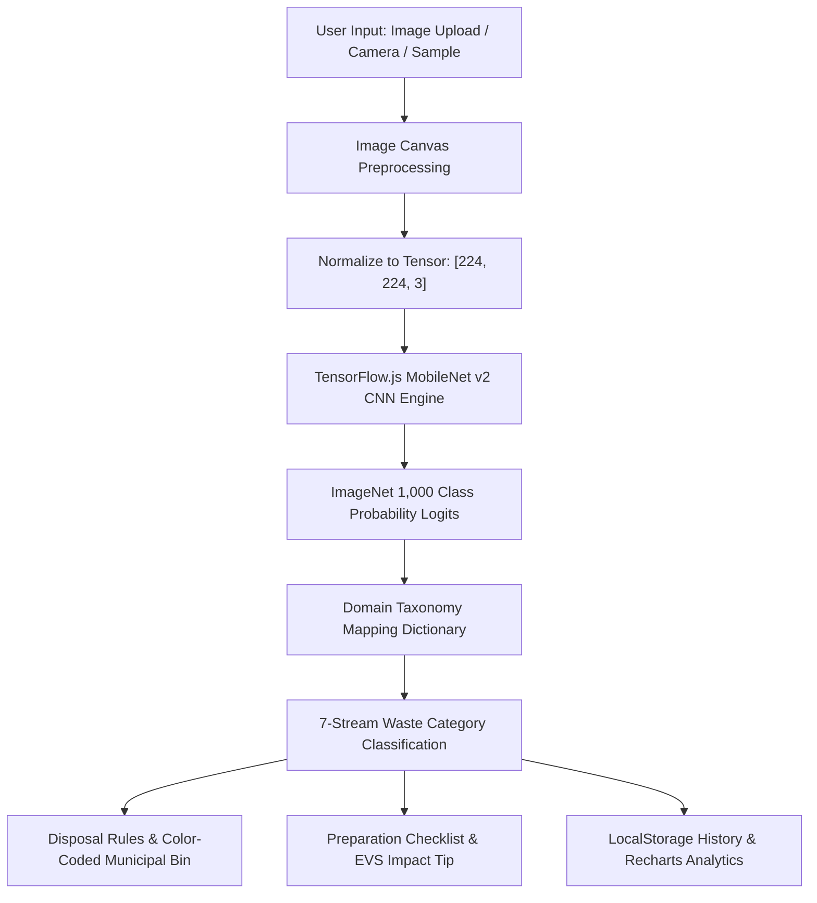

# 🌱 Intelligent Waste Segregation Using Computer Vision
> **"Smarter Sorting. Cleaner Tomorrow."**  
> An AI-driven, edge-computed waste classification and environmental awareness platform built for academic Environmental Studies (EVS).

[](https://react.dev/)
[](https://vitejs.dev/)
[](https://tailwindcss.com/)
[](https://www.tensorflow.org/js)
[](https://recharts.org/)
[](https://opensource.org/licenses/MIT)

---

## 📑 Table of Contents

- [1. Problem Statement](#1-problem-statement)
- [2. Our Solution](#2-our-solution)
- [3. Key Features](#3-key-features)
- [4. Complete Technology Stack](#4-complete-technology-stack)
- [5. System Architecture & How It Works](#5-system-architecture--how-it-works)
- [6. Waste Classification Streams](#6-waste-classification-streams)
- [7. Project Directory Structure](#7-project-directory-structure)
- [8. Installation & Setup](#8-installation--setup)
- [9. Application Pages & Workflow](#9-application-pages--workflow)
- [10. Academic Viva & Defense Q&A](#10-academic-viva--defense-qa)
- [11. Future Roadmap](#11-future-roadmap)
- [12. Contributing & License](#12-contributing--license)

---

## 1. Problem Statement

Modern urbanization produces over **2 billion tonnes of municipal solid waste (MSW) annually**, with a projected 70% increase by 2050. Despite the existence of recycling infrastructure, less than 20% of waste is recycled globally.

### Critical Challenges:
* **Cross-Contamination at Source:** When wet organic waste mixes with dry recyclables (paper, cardboard), moisture and grease break down cellulose fibers, rendering entire municipal truckloads unrecyclable and heading straight to landfills.
* **Cognitive Load & Citizen Confusion:** Complex packaging, non-intuitive Resin Identification Codes (RIC 1–7), and diverging municipal bin color schemes cause widespread sorting mistakes.
* **Landfill Methane Emissions:** Anaerobic decomposition of misdirected organic waste in open dump yards produces methane ($CH_4$), a greenhouse gas over **28 times more potent** than carbon dioxide ($CO_2$).
* **Privacy & Bandwidth Overhead in Cloud AI:** Traditional computer vision applications transmit high-resolution imagery to remote cloud servers, causing bandwidth delays, subscription costs, and user privacy risks.

---

## 2. Our Solution

**Intelligent Waste Segregation Using Computer Vision** is an interactive, browser-based green-tech solution designed for educational curricula and municipal source-sorting education.

* ⚡ **100% Client-Side Edge AI:** Runs a deep Convolutional Neural Network (MobileNet v2) directly inside the user's web browser using TensorFlow.js. Zero server upload latency, complete offline readiness, and 100% data privacy.
* ♻️ **7 Standard Global Streams:** Automatically classifies waste into **Plastic, Paper & Cardboard, Metal & Cans, Glass, Organic Waste, E-Waste, and Residual/General Waste**.
* 📋 **Actionable Municipal Guidance:** Provides pre-disposal preparation steps (e.g., *rinse food residues, detach plastic screw caps, flatten cardboard*) alongside municipal bin color standards (Swachh Bharat, EU, and North American conventions).
* 📊 **Environmental Impact Analytics:** Computes live environmental metrics, including estimated landfill volume diverted and greenhouse gas equivalents avoided.

---

## 3. Key Features

- **Real-Time Computer Vision Inference:** Upload or drag-and-drop any item image; the in-browser model analyzes optical patterns and extracts feature vectors instantly.
- **Dual Inference Modes:**
  - **Live AI Mode:** Processes user-provided photos using TensorFlow.js & MobileNet v2.
  - **Curated Demonstration Gallery:** Pre-verified real-world samples (water bottles, delivery boxes, crushed cans, apple cores, discarded electronics) for foolproof viva/classroom demonstrations.
  - **Manual Inspection Mode:** Allows students or examiners to study any stream's recycling metrics and handling rules without uploading images.
- **Dynamic Laser Scan Animation:** Visually simulates optical sensor tensor extraction while the model evaluates ImageNet logits.
- **Recycling Celebration:** Triggers interactive confetti animations when recyclable or compostable items are identified to gamify eco-friendly habits.
- **Comprehensive Analytics Dashboard:**
  - Donut and bar charts powered by Recharts showing category distribution and diversion rates.
  - Estimated ecological savings (landfill space saved in liters, $CO_2$ avoided in kg).
  - Searchable, filterable scan history stored locally with individual item deletion, inspection modal, and JSON export.
- **Cross-Jurisdiction Bin Standards:** Comparative guide contrasting India's **Swachh Bharat 3-stream system**, the European Union's **multi-stream model**, and North America's **single-stream recycling**.

---

## 4. Complete Technology Stack

| Layer | Technology | Version | Purpose |
|---|---|---|---|
| **Frontend Framework** | [React](https://react.dev/) | `^18.3.1` | Component-driven UI architecture, reactive state management |
| **Build Tool & Bundler** | [Vite](https://vitejs.dev/) | `^6.1.1` | Ultra-fast HMR (Hot Module Replacement) and optimized bundling |
| **Styling & Design System** | [Tailwind CSS](https://tailwindcss.com/) | `^3.4.17` | Utility-first CSS with customized eco-friendly green color palette |
| **PostCSS & Autoprefixer** | [PostCSS](https://postcss.org/) | `^8.4.49` | CSS transformation and cross-browser vendor prefixing |
| **Computer Vision / ML** | [TensorFlow.js](https://www.tensorflow.org/js) | MobileNet v2 | In-browser deep CNN inference without backend server overhead |
| **Data Visualization** | [Recharts](https://recharts.org/) | `^2.15.1` | Responsive SVG charts (Donut & Bar charts) for waste analytics |
| **Icons** | [Lucide React](https://lucide.dev/) | `^0.475.0` | Accessible, clean icons for streams, bins, and UI controls |
| **Visual Effects** | [Canvas-Confetti](https://www.npmjs.com/package/canvas-confetti) | `^1.9.4` | Particle physics celebration on recyclable detections |
| **Storage & Persistence** | Browser LocalStorage API | Native | Persists user scan logs, impact metrics, and user preferences locally |

---

## 5. System Architecture & How It Works



### Step-by-Step Processing Pipeline:
1. **Input Ingestion:** The user uploads an image (JPG, PNG, or WEBP up to 10MB) or selects a curated educational sample.
2. **Tensor Preprocessing:** An in-memory HTML5 Canvas normalizes the pixel data into a `[224, 224, 3]` dimension tensor with values scaled to standard ImageNet normalization ranges.
3. **Deep Feature Extraction:** TensorFlow.js executes MobileNet v2 (inverted residual blocks with linear bottlenecks) client-side in WebGL/WebAssembly.
4. **Taxonomy Mapping:** The model's top-k ImageNet classifications are parsed through an intelligent domain dictionary (`IMAGENET_WASTE_MAP`), bridging generic object categories (e.g., `'pop bottle'`, `'carton'`, `'banana'`) into standard ecological waste streams.
5. **Guidance Dispatch:** The UI presents the assigned waste category, confidence score, recommended municipal bin, preparation instructions, and estimated decomposition timeline.
6. **Analytics Logging:** The scan result is saved to `localStorage`, automatically updating the diversion rate and chart visualizers.

---

## 6. Waste Classification Streams

| Waste Category | Recyclability | Municipal Bin | Decomposition Time | Practical Preparation Steps |
|---|---|---|---|---|
| **Plastic** | Highly Recyclable | **Blue / Yellow** | 450 – 1000 Years | Empty liquids, rinse residue, crush to save bin volume, check RIC code. |
| **Paper & Cardboard** | Commonly Recyclable | **Blue** | 2 – 6 Weeks | Keep dry, remove plastic adhesive tape, flatten corrugated boxes. |
| **Metal & Cans** | Infinitely Recyclable | **Yellow / Gray** | 50 – 500 Years | Rinse food residue, leave pull-tabs attached, avoid crushing aerosol cans. |
| **Glass** | Infinitely Recyclable | **Green** | 1,000,000+ Years | Rinse thoroughly, separate metal/plastic caps, avoid mixing Pyrex/ceramics. |
| **Organic Waste** | 100% Compostable | **Green / Brown** | 2 Weeks – 6 Months | Keep free of plastic wrap/stickers, drain excess moisture, ideal for composting. |
| **E-Waste** | Special Handling | **Red / E-Center** | Does not degrade | Remove batteries, do not discard in regular bins, route to certified e-waste recyclers. |
| **Residual / General** | Non-Recyclable | **Black / Gray** | Indefinite / Decades | Bag securely, limit volume, explore reusable non-composite alternatives. |

---

## 7. Project Directory Structure

```text
Intelligent Waste Segregation Using Computer Vision/
├── public/                     # Public static assets & favicons
├── src/
│   ├── assets/                 # Graphics, logos, and hero banners
│   │   ├── hero.png
│   │   ├── react.svg
│   │   └── vite.svg
│   ├── components/             # Reusable modular UI components
│   │   ├── ClassificationResult.jsx  # Card displaying stream, bin, and action steps
│   │   ├── Footer.jsx                # Responsive footer with environmental links
│   │   ├── ImageUploader.jsx         # Drag-and-drop uploader with sample selectors
│   │   ├── Navbar.jsx                # Navigation header with active route styling
│   │   └── WasteCategoryCard.jsx     # Card for individual waste category details
│   ├── pages/                  # Main application views
│   │   ├── About.jsx           # EVS background, architecture, and viva defense guide
│   │   ├── Categories.jsx      # 7-Stream directory with bin color comparisons
│   │   ├── Dashboard.jsx       # Analytics, Recharts graphs, and history logs
│   │   ├── Home.jsx            # Landing page with 3-step workflow & eco stats
│   │   └── Scanner.jsx         # Main scanning interface with live inference
│   ├── services/
│   │   └── classificationService.js # TensorFlow.js MobileNet loader & taxonomy engine
│   ├── utils/
│   │   ├── storage.js          # LocalStorage CRUD, export/import, impact math
│   │   └── wasteCategories.js  # Waste stream master data, bin specs & test items
│   ├── App.css                 # Custom animations and scanning laser keyframes
│   ├── App.jsx                 # Application layout, state management, and routing
│   ├── index.css               # Tailwind CSS directives and theme variables
│   └── main.jsx                # React application entry point
├── .gitignore                  # Git ignore rules for node_modules, build, and secrets
├── index.html                  # HTML entry point with meta tags & mobile viewports
├── package.json                # Project dependencies, scripts, and metadata
├── postcss.config.js           # PostCSS plugins configuration
├── tailwind.config.js          # Tailwind CSS theme extensions & custom color palette
└── vite.config.js              # Vite configuration with React plugin
```

---

## 8. Installation & Setup

### Prerequisites
* [Node.js](https://nodejs.org/) (`v18.0.0` or higher recommended)
* `npm` (comes with Node.js) or `yarn` / `pnpm`

### 1. Clone or Download Repository
```bash
git clone https://github.com/<your-username>/intelligent-waste-segregation-cv.git
cd intelligent-waste-segregation-cv
```

### 2. Install Dependencies
```bash
npm install
```

### 3. Start Development Server
```bash
npm run dev
```
Open your browser and navigate to the local server URL (usually `http://localhost:5173`).

### 4. Build for Production
To create an optimized, minified production build:
```bash
npm run build
```
The compiled assets will be placed in the `dist/` directory, ready for deployment to Vercel, Netlify, or GitHub Pages.

### 5. Preview Production Build
```bash
npm run preview
```

---

## 9. Application Pages & Workflow

1. **Home (`/`):**
   - High-impact environmental hero banner highlighting the project motto.
   - Interactive 3-step workflow (*Upload Image → AI Visual Analysis → Dispose Responsibly*).
   - Global waste crisis statistics and circular economy awareness.

2. **Scanner (`/scanner`):**
   - Drag-and-drop image upload supporting JPEG, PNG, and WEBP formats.
   - Live visual scanline laser animation during model inference.
   - Comprehensive result card displaying the detected stream, confidence percentage, color-coded municipal bin, item preparation checklist, and EVS environmental insight.
   - 1-click curated test items gallery for instant demonstrations.

3. **Categories Guide (`/categories`):**
   - Detailed breakdown of all 7 waste categories with Resin Identification Codes (RIC 1–7).
   - Decomposition timelines and common disposal mistakes to avoid.
   - International bin color comparison table (India Swachh Bharat vs. European Union vs. North America).

4. **Analytics Dashboard (`/dashboard`):**
   - Key Performance Indicators: Total Scanned, Recyclables Diverted, Compostable Organic, and Landfill Diversion Rate.
   - Interactive Donut Chart (Stream Distribution) and Bar Chart (Recyclability Breakdown) built with Recharts.
   - Illustrative environmental savings (landfill space saved in Liters, $CO_2$ equivalent emissions avoided).
   - Searchable scan history list with item detail modal, individual deletion, and one-click JSON export.

5. **About & Viva Defense Guide (`/about`):**
   - Exploration of Municipal Solid Waste (MSW) challenges and cross-contamination mechanisms.
   - Technical architecture diagram and edge inference workflow.
   - Technical challenges and limitations (composite packaging, surface grease, transparency refraction).
   - Dedicated Viva Defense Q&A bank designed for college examinations.

---

## 10. Academic Viva & Defense Q&A

For college project viva and technical presentations, here are the most commonly asked examiner questions:

* **Q1: Why is segregation at the source far superior to post-collection mechanical sorting?**  
  *Answer:* Once wet organic food waste mixes with dry recyclables (paper, cardboard), moisture and grease break down cellulose fibers, rendering whole truckloads unrecyclable. Source segregation preserves raw material purity and dramatically reduces municipal processing costs.

* **Q2: Why use client-side in-browser inference rather than sending images to a cloud API?**  
  *Answer:* Client-side inference with TensorFlow.js provides zero-latency feedback, functions without active internet once loaded, guarantees 100% user data privacy (images never leave the device), and has zero backend server costs.

* **Q3: Are municipal bin colors globally standardized?**  
  *Answer:* No. Bin colors vary by region and municipality. For example, India's Swachh Bharat mission specifies Blue for dry recyclables and Green for wet waste; the European Union commonly uses Blue for paper, Yellow for plastics/metals, and Brown for bio-waste. The application includes an international comparison guide to clarify these standards.

* **Q4: What are the primary technical limitations of visual waste classification?**  
  *Answer:* Optical vision alone cannot detect multi-layer composite packaging (e.g., Tetra Paks with bonded paper, aluminum, and plastic), subsurface food grease contamination, or distinguish certain transparent plastics (PET vs. PVC) without near-infrared spectroscopy (NIR).

---

## 11. Future Roadmap

- [ ] **Hardware Smart Bin Integration:** Porting the inference pipeline to an embedded microcontroller (Raspberry Pi / ESP32-CAM) with servo-motor actuated bin lids.
- [ ] **Custom Fine-Tuned Object Detection:** Training a custom YOLOv8 / MobileNet model specifically on the TACO (Trash Annotations in Context) dataset for multi-item multi-class localization.
- [ ] **Barcode & QR Packaging Scanner:** Integrating camera-based barcode scanning to identify exact municipal recycling instructions directly from product packaging databases.
- [ ] **Progressive Web App (PWA):** Adding full offline caching service workers and home-screen installability for mobile users.

---

## 12. Contributing & License

This project was developed for academic **Environmental Studies (EVS)** curriculum requirements and open-source green-tech education.

Distributed under the **MIT License**. See `LICENSE` for more information.

---

<div align="center">
  <sub>Built with ❤️ for a cleaner, greener tomorrow.</sub>
</div>
